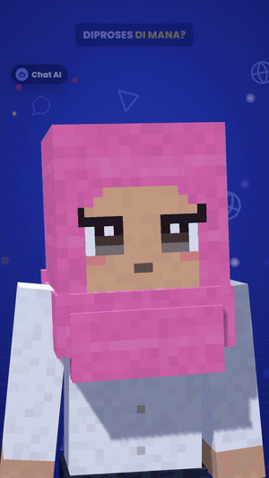
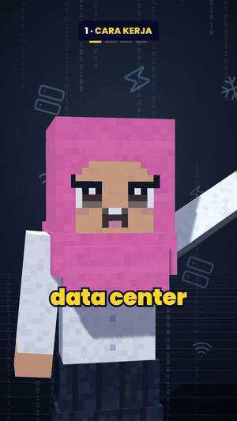
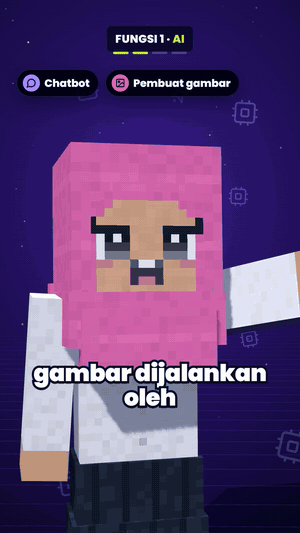
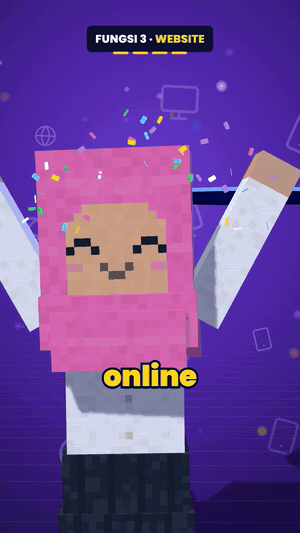
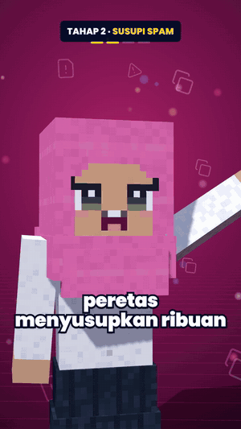
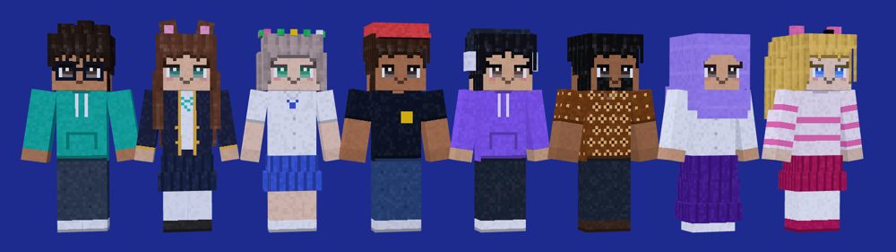

# treemation

📦 [View on skills.sh](https://skills.sh/Adytm404/treemation/treemation)

**Bikin video edukasi 3D vertikal (TikTok / Reels / Shorts) sepenuhnya dengan code — dari satu kalimat topik sampai MP4 + thumbnail.**

An AI agent skill that turns a topic into a narrated, animated 9:16 explainer video: script for ElevenLabs, scene plan, a 3D stage with a pixel-skin host and mascot, word-by-word captions, vowel lip sync, sound effects, adaptive backgrounds, and a cover thumbnail. Built for Indonesian-language educational content.

## Demo

All clips below were rendered by this skill (no video editor, no stock footage).

<table>
  <tr>
    <td align="center"><br><sub>Hook 0–3 s</sub></td>
    <td align="center"><br><sub>3D props</sub></td>
    <td align="center"><br><sub>Custom props</sub></td>
    <td align="center"><br><sub>UI + 3D sync</sub></td>
    <td align="center"><br><sub>Adaptive background</sub></td>
  </tr>
</table>

▶️ **With sound:** [docs/demo/sample-datacenter.mp4](docs/demo/sample-datacenter.mp4) — a 15-second scene from *"Gimana data center bekerja?"* (narration generated with ElevenLabs).

<table>
  <tr>
    <td align="center"></td>
    <td align="center"></td>
  </tr>
  <tr>
    <td align="center"><sub>Auto-generated cover</sub></td>
    <td align="center"><sub>Safe-area checked for profile grids</sub></td>
  </tr>
</table>

**Character presets** (original pixel-skin designs, fully customizable — hair, hijab, outfit, colors, accessories):



## Install

### Claude Code (plugin)

Run this inside Claude Code (version 2.1.275 or later):

```
/plugin install treemation --marketplace Adytm404/treemation
```

Or in two steps, which also works on older versions:

```
/plugin marketplace add Adytm404/treemation
/plugin install treemation@treemation
```

From a terminal instead:

```bash
claude plugin marketplace add Adytm404/treemation
claude plugin install treemation@treemation
```

Update later with `/plugin marketplace update treemation`.

### Any agent (skills.sh)

```bash
npx skills add Adytm404/treemation --skill treemation
```

> Run the command above, select your AI agent when prompted, then restart the agent so it can detect the skill.

## How it works

The skill runs in two steps. Each step is triggered by a single message.

### 1. Topic → script

```
buat konten edukasi: apa itu domain, CTA ke tokoku.id
```

The agent replies directly with:

- A ready-to-paste **ElevenLabs script** (numbers and acronyms written the way they are spoken, e.g. "zenhosta dot com" → caption shows `zenhosta.com`).
- **Three hook options** of different types (curious question, misconception, "what if", analogy, …) checked against hook rules for the first 3 seconds.
- The **host character** chosen from your context (or described by you), plus mascot.
- A **thumbnail** plan and a **scene table** with timing, camera shots, background theme, and visuals.
- `video-plan.json` with every scene, shot, gesture, sound effect, and per-word caption timing.

### 2. MP3 → video

Generate the narration in ElevenLabs, then send the MP3. The agent processes it end to end without further questions:

1. **Aligns** the plan to the audio (silence detection + punctuation, no AI model needed).
2. Writes `scenes.js` — 3D props on a floating stage and UI panels timed to the exact word that explains them.
3. Renders **preview stills**, checks them, and fixes overlaps.
4. Renders all frames with headless Chromium, builds the **thumbnail**, mixes **sound effects** under the narration, and encodes a **1080×1920 30 fps H.264 MP4**.

## Features

| | |
|---|---|
| 🎬 Dynamic camera | Close-up, medium, mascot close-up, illustration, wide, low angle — cuts and moves on the right word |
| 🧍 Pixel-skin host | Blocky game-style character with pixel anime face; 8 presets, hijab, outfits, skin tones, accessories |
| 👄 Vowel lip sync | Mouth shapes A · I · U · E · O follow each word's vowels and close on pauses; foreign words read by pronunciation |
| 🎥 Clear camera | Characters vanish or slide straight out of frame before the camera focuses on props — never walking across the shot |
| 🎨 Adaptive background | Theme, particles (bokeh, stars, bubbles, snow, binary code) and motif icons change per scene |
| 🪝 Hook rules | 3-layer hook (visual, voice, on-screen text) with an automatic lint before the script is sent |
| 💬 Captions | Big word-by-word karaoke captions, keywords highlighted in yellow, zoom punch on key words |
| 🎯 Precise timing | Optional Whisper word timestamps (`--whisper`) for exact caption and lip-sync timing |
| 🎭 Acting | Expressive poses (explain, clap, hands on hips), mascot reactions, squash-and-stretch, cartoon outlines |
| 🔊 Sound effects | Whoosh, pop, ding, chime, typing, count-up, boom… generated procedurally and mixed under the voice |
| 🎵 Background music | Your own track or a royalty-free code-generated one (`--music auto`), ducked under the narration |
| ⚡ GPU rendering | Optional `--gpu` render (3–10× faster on machines with a graphics card) |
| 🖼️ Thumbnail | 1080×1920 cover with title, props, frozen pose, and a safe-area check for 3:4 / 4:5 / 1:1 crops |

## Prerequisites

- **Node.js + npm** — installs three.js, fonts, and icons per project
- **Python 3** with `numpy` (and `pillow` for the thumbnail safe-area check)
- **ffmpeg**
- **Playwright Chromium** — `pip install playwright && python -m playwright install chromium`
- *Optional:* `faster-whisper` for precise word timing (`pip install faster-whisper`, first model download ±500 MB)

The setup script checks these and tells the agent what is missing.

## Supported agents

Any agent that supports the `SKILL.md` format, including Claude Code, Codex, Cursor, and OpenCode.

## Project layout

One video = one folder:

```
video-apa-itu-domain/
├── plan.json               # script, scenes, shots, characters, hook, thumbnail
├── naskah-elevenlabs.txt   # text to paste into ElevenLabs
├── video-plan.json         # timing (estimated, then aligned to the audio)
├── narasi.mp3              # your ElevenLabs narration
├── scenes.js               # props + UI for this video
├── thumbnail.png
└── <name>.mp4
```

## Skill contents

```
skills/treemation/
├── SKILL.md
├── references/      # script & plan schema, hook research, characters, engine API, reply format
├── scripts/         # setup, timing, align, render, thumbnail, encode, character preview, project finder
├── assets/engine/   # three.js engine, pixel-skin characters, page template
└── examples/        # a complete 69-second example (plan.json + scenes.js)
```

## Notes

- Scripts, captions, and replies are in **Bahasa Indonesia**.
- Characters are original designs. The skill avoids copying characters, skins, or mascots from other creators, games, or brands.
- Educational content should be accurate: the skill writes example numbers from documentation ranges or clearly labeled data, and CTAs only state what you provide.

## License

[MIT](LICENSE) © 2026 Adytm404
